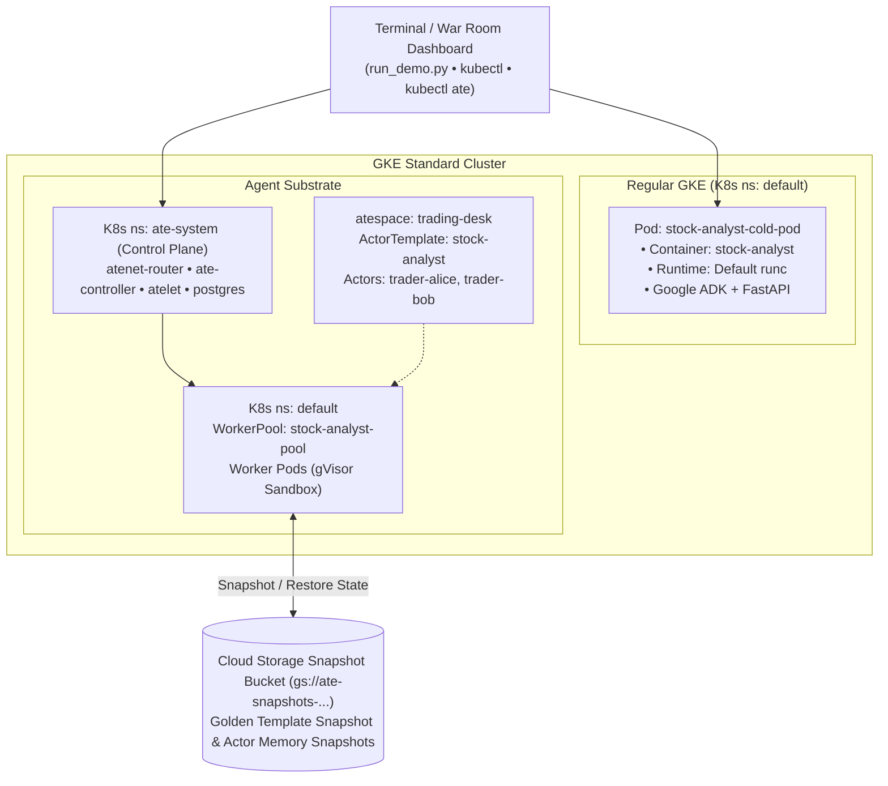

# GKE Agent Substrate vs. Standard GKE: Share Price & Volatility War Room (`gke_substrate_stocks`)

A side-by-side benchmark and visual split-screen demo comparing **Standard GKE Sandboxed Pods (`runtimeClassName: gvisor`)**, **GKE Agent Sandbox (`SandboxWarmPool`)**, and **GKE Agent Substrate (`WorkerPool` + `ActorTemplate`)** using an identical **Google ADK Financial & Volatility Analyst Agent**.

---

## 🎯 What This Demo Shows

1. **Act 1 — Session Spin-Up Race (`~380ms` vs. `~8.6s`):**
   - **Standard GKE (`kind: Pod`):** Cold-starts a dedicated Pod per session (Pod scheduling → container image pull/unpack → Python 3.12 + FastAPI + `google-adk` initialization), taking **8–12 seconds** before the first stock analysis can run.
   - **GKE Agent Substrate (`WorkerPool` + `ActorTemplate`):** Claims a warm gVisor worker Pod from a `WorkerPool` and restores a golden memory snapshot where Python, FastAPI, and `google-adk` are already initialized in RAM—waking and analyzing `NVDA` in **~380ms (>20× faster)**.
2. **Act 2 — Idle Suspend, `0ms` Hardware Reuse & Stateful Teleportation:**
   - When Trader Alice pauses to read the `NVDA` chart, Agent Substrate snapshots her process RAM to Cloud Storage in **~96ms** and releases `Worker #1 (10.40.1.08)` back to the `WorkerPool` (**0 CPU / 0 MiB RAM billed while idle**).
   - Trader Bob requests `MSFT` and immediately lands on `Worker #1 (10.40.1.08)` with **0ms hardware provisioning**.
   - While Bob occupies `Worker #1`, Alice asks a follow-up on `GOOGL`. Agent Substrate restores Alice's memory snapshot onto `Worker #2 (10.40.1.12)` in **~390ms**—preserving her in-memory `resident_secret` (`FOLIO-...`) and `portfolio_history` (`['NVDA', 'GOOGL']`) across physical Pods **without an external database**.
3. **Act 3 — On-the-Fly Code Execution & Sandbox Isolation Audit (`/run_fly_script`):**
+   - Executes a dynamic Python risk script on the fly (computing `NVDA` Sharpe Ratio) while auditing kernel isolation (`os.uname().release`, `/dev/kmsg`, `AF_PACKET` raw sockets, and mounted KSA tokens)—proving that **Agent Substrate's gVisor sandbox** traps untrusted code inside the `4.4.0` user-space Sentry kernel and hides the GKE node kernel.

---

## 🏗️ Deployed Architecture Overview



---

## 📁 Repository Structure

```text
gke_substrate_stocks/
├── agent/
│   ├── agent.py                        # Google ADK Financial Analyst + get_stock_quote & calculate_volatility tools
│   ├── main.py                         # FastAPI server with pure in-memory PORTFOLIO_STATE & Pod IP tracking
│   ├── requirements.txt                # Python dependencies
│   └── Dockerfile                      # Container image used across all 3 GKE execution models
├── manifests/
│   ├── standard-gke-pod.yaml           # Model A: Standard GKE on-demand Pod (template with placeholders)
│   ├── sandbox-warmpool.yaml           # Model B: GKE Agent Sandbox (SandboxTemplate + SandboxWarmPool)
│   ├── substrate-workerpool.yaml       # Model C: GKE Agent Substrate WorkerPool (ate.dev/v1)
│   └── substrate-actor-template.yaml   # Model C: GKE Agent Substrate ActorTemplate (SNAPSHOT_CONTENT_SCOPE_FULL)
├── samples/
│   ├── standard-gke-pod.yaml           # Populated sample of standard-gke-pod.yaml
│   ├── sandbox-warmpool.yaml           # Populated sample of sandbox-warmpool.yaml
│   ├── substrate-workerpool.yaml       # Populated sample of substrate-workerpool.yaml
│   └── substrate-actor-template.yaml   # Populated sample of substrate-actor-template.yaml
├── dashboard/
│   ├── index.html                      # Visual Split-Screen War Room UI (works standalone or with server.py)
│   └── server.py                       # Optional local FastAPI server bridging UI to live GKE cluster
└── run_demo.py                         # Python demo test script (--test 1, 2, 3, or all)
```

---

## 🚀 Quickstart

### Option A: Preview the Visual Split-Screen Dashboard Immediately
You can open `dashboard/index.html` directly in any browser, or run the local dashboard server:

```bash
python3 dashboard/server.py
# Open http://localhost:8090
```

### Option B: Deploy & Run on a Live GKE Cluster

#### 1. Build and Push the Agent Image (via Cloud Build)
```bash
export PROJECT_ID=$(gcloud config get-value project)
export REGION="us-central1"
export IMAGE="${REGION}-docker.pkg.dev/${PROJECT_ID}/agent-demo/stock-analyst:v1"

gcloud artifacts repositories create agent-demo \
    --repository-format=docker \
    --location=${REGION} || true

gcloud builds submit --tag ${IMAGE} ./agent

# Retrieve the @sha256 digest-pinned image URI required by ActorTemplate
export IMAGE_DIGEST=$(gcloud artifacts docker images describe ${IMAGE} \
    --format='value(image_summary.fully_qualified_digest)')
echo "Digest-pinned image: ${IMAGE_DIGEST}"
```

#### 2. Install Agent Substrate on GKE Standard
```bash
curl -sSL https://raw.githubusercontent.com/ai-on-gke/substrate-gke/main/install.sh | bash

# Set your cluster name and zone, then grant the node pool Service Account read access to agent-demo
export CLUSTER_NAME="gke-substrate-001"
export ZONE="us-west1-c"
export NODE_SA=$(SA=$(gcloud container node-pools describe substrate-node-pool \
    --cluster=${CLUSTER_NAME} --zone=${ZONE} --project=${PROJECT_ID} \
    --format='value(config.serviceAccount)'); \
    [ "$SA" = "default" ] && echo "$(gcloud projects describe ${PROJECT_ID} --format='value(projectNumber)')-compute@developer.gserviceaccount.com" || echo "$SA")

gcloud artifacts repositories add-iam-policy-binding agent-demo \
    --location=${REGION} --project=${PROJECT_ID} \
    --member="serviceAccount:${NODE_SA}" \
    --role="roles/artifactregistry.reader"
```

#### 3. Deploy the `WorkerPool`, `ActorTemplate`, and Standard GKE Comparison Pod
Replace the placeholder values in the YAML files under `manifests/` with your environment's values (see the [`samples/`](./samples/) folder for fully populated examples):
* **`IMAGE_DIGEST_PLACEHOLDER`** *(in `manifests/substrate-actor-template.yaml`)*: Your `@sha256` digest-pinned Artifact Registry image from Step 1 (`${IMAGE_DIGEST}`).
* **`IMAGE_PLACEHOLDER`** *(in `manifests/standard-gke-pod.yaml`)*: Your Artifact Registry image from Step 1 (`${IMAGE}`).
* **`WORKER_IMAGE_PLACEHOLDER`** *(in `manifests/substrate-workerpool.yaml`)*: Your `ateworker-gvisor` image from the installer (e.g., `ghcr.io/agent-substrate/substrate/ateworker-gvisor:v1.0.0`, verifiable via `kubectl get ds atelet -n ate-system -o wide`).

Then apply the manifests and verify that your resources are up and running:
```bash
# 1. Apply the Agent Substrate WorkerPool
kubectl apply -f manifests/substrate-workerpool.yaml

# 2. Create the trading-desk atespace and ActorTemplate
kubectl ate create atespace trading-desk
kubectl ate create actor-template -f manifests/substrate-actor-template.yaml

# 3. Verify that the WorkerPool Pods and ActorTemplate are Running / Ready
kubectl get workerpools -n default
kubectl get pods -n default -o wide
kubectl ate get atespace 2>/dev/null
kubectl ate get actor-template -a trading-desk 2>/dev/null
```

#### 4. Run the Side-by-Side Tests (Individually or All Together)
```bash
# Run each risk test individually (automatically creates trader-alice and trader-bob):
python3 run_demo.py --test 1   # Test 1: The Speed Risk (Cold Pod vs. Warm Worker)
python3 run_demo.py --test 2   # Test 2: The Idle Risk (Suspend, Reuse & Teleport RAM)
python3 run_demo.py --test 3   # Test 3: The Isolation Risk (On-the-Fly Code & Kernel Probe)

# Inspect both trader actors in the trading-desk atespace:
kubectl ate get actor -a trading-desk 2>/dev/null

# Or run all three tests in sequence:
python3 run_demo.py --test all
```
